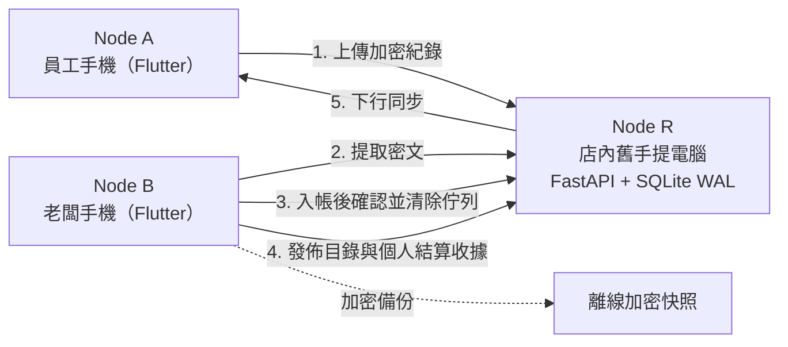

# P2PServiceApp

離線優先的單店回佣與帳務系統：以店內電腦作為盲遞中繼，在無外網、不依賴雲端伺服器的前提下，連接員工手機與老闆手機，完成服務紀錄上行、對帳結算與裝置權限管理。

本專案的完整目標架構與密碼學規格載於 [`docs/SSD_v2.1.md`](docs/SSD_v2.1.md)（System Specification & Sequence Document v2.1）。倉庫目前只實作了規格中的 **Node R（店內中繼）** 上行路徑；員工端與老闆端應用程式尚未納入本倉庫。

## 本專案要解決什麼問題

根據規格第 1 至 2 節，本系統是為實體按摩門市設計、在無外網與零雲端伺服器成本前提下運作的帳務流程，目標包含下列五個閉環：

1. **信任建立與撤銷**：在店內完成老闆與員工裝置的公鑰登記；員工離職後可撤銷寫入權限。
2. **服務紀錄上行**：員工可離線建檔，再把已加密的上行信封送到店內中繼。
3. **提領、核對與清除**：老闆提取密文、在本機入帳後，才指示中繼刪除已確認的佇列紀錄。
4. **回佣結算與目錄下行**：老闆簽發結算收據並發佈服務目錄，由員工下行同步（規格已載明，尚未實作）。
5. **災難復原**：以離線助記詞衍生主金鑰，並為總帳與中繼金鑰建立加密快照（規格已載明，尚未實作）。

中繼機的角色是「盲目存儲」：只保存已加密信封，不持有解密私鑰，不以明文處理服務金額或客人紀錄。

## 架構概覽

下圖依規格第 4 節整理，描述**目標架構**。實線為規格中的資料流向；目前倉庫已實作的，只有 Node R 上的上行上傳、提取、確認與狀態查詢。



| 節點 | 規格中的設備與技術 | 權限邊界（摘自規格第 2 節） |
| --- | --- | --- |
| **Node A** | 員工手機，Flutter 應用程式 | 只能上傳自己簽章的加密紀錄，並讀取全域目錄及「收件人為本人」的結算收據；不可提取或刪除佇列。 |
| **Node R** | 店內舊手提電腦，Ubuntu、Python FastAPI、SQLite（WAL） | 驗證請求簽章、時間戳與 Nonce；以密文形式暫存上行資料。無解密私鑰。 |
| **Node B** | 老闆專用手機，Flutter 應用程式 | 提取上行密文、確認後清除佇列、發佈目錄與結算收據、管理裝置白名單（完整能力見規格）。 |

完整架構圖與時序圖見規格第 4、5 節。

## 倉庫目錄

下列為 `main` 分支現有內容（基準 commit：`06a3c7786bb09f125617b0de174056115caf598b`）：

```
P2PServiceApp/
├── README.md                 # 本說明（倉庫封面）
├── docs/
│   └── SSD_v2.1.md           # 系統規格書 v2.1
└── node-r/                   # Node R 可運行實作
    ├── README.md             # 安裝、啟動、簽署格式與 API 說明
    ├── node_r.py             # FastAPI 服務與裝置登記／撤銷指令
    ├── client_demo.py        # 上傳 → 提取 → 確認 → 查狀態的示範客戶端
    ├── test_node_r.py        # pytest 單元測試（19 項）
    ├── requirements.txt      # fastapi、uvicorn、pynacl、pydantic、pytest、httpx
    └── .gitignore            # 排除資料庫、虛擬環境、私鑰與憑證
```

倉庫根目錄目前沒有授權條款檔（`LICENSE`），也沒有員工端或老闆端的應用程式原始碼。

## 現況：已實作與仍屬規格

請把「規格已寫明」和「程式已落地」分開看待。以下現況以 `main` 分支上述 commit 為準。

### 已實作（`node-r/`）

- FastAPI 服務，SQLite 以 WAL 模式運作。
- 裝置以 Ed25519 公鑰登記；請求以裝置私鑰簽署。
- 角色分離：`THERAPIST` 只能上傳與查狀態；`BOSS` 只能提取與確認（ack）。
- 以 Nonce 防止時間窗內重放；時間偏差預設容許 ±300 秒。
- 信封視為不透明密文保存，服務本身不解密內容。
- 用量限制：解碼後信封上限 64 KB、每部裝置待處理 5,000 筆、請求本文上限 128 KB；磁碟剩餘少於 200 MB 時回傳 507。
- 預設綁定 `127.0.0.1`；可設定私有網段（CIDR）允許清單；可選 TLS。
- 確認時先寫入 `ack_log`，再刪除佇列中確實存在的列；已清除的紀錄可經狀態查詢回報為 `acked`。
- 本機 CLI：`register`、`revoke`、`serve`。
- 附 19 項單元測試，以及端到端示範腳本。`node-r/README.md` 另提供 systemd 單元示例。

### 規格已載明、本倉庫尚未實作

- Node A、Node B 的 Flutter 應用程式，以及兩端的本地資料庫、報表與對帳介面。
- 規格第 3 節的端到端封裝：RFC 8785 規範化序列化、雜湊鏈、`X25519` + `XChaCha20-Poly1305` 混合加密、BIP-39 助記詞衍生主金鑰。
- 下行 API：目錄發佈、結算收據發佈與同步、下行確認。
- 以 QR Code 完成公鑰交換、TLS SPKI 憑證釘選、mDNS／熱點備援、換機還原與加密快照備份。
- 應用程式派發方式（規格第 9.3 節所述的內網 APK 頁面及 iOS 方案）。

### 現行 Node R 與 SSD v2.1 的差異

現行實作為可在本機驗證的強化中繼，並未完全對齊規格草稿中的 Node R 定義。主要差異如下：

| 項目 | SSD v2.1 | 現行 `node-r` 實作 |
| --- | --- | --- |
| 收件簽章 `relay_sig` | `uplink_queue` 必填，並隨提取一併回傳 | 尚未實作 |
| 裝置加密公鑰 `encrypt_pub_key` | `device_registry` 必填，供下行收據加密 | 尚未實作（登記只保存 Ed25519 驗簽公鑰） |
| 下行與裝置管理 API | `/downlink/*`、`POST /api/v2/admin/devices` | 尚未實作；裝置登記與撤銷使用本機 CLI |
| 佇列確認 | `POST /api/v2/uplink/purge` | `POST /api/v2/uplink/ack`；`DELETE /api/v2/uplink/purge` 為其別名 |
| 員工查詢送達狀態 | 規格 API 表未列此端點 | 另提供 `GET /api/v2/uplink/status` |
| 佇列唯一鍵 | `client_record_id` 全域唯一 | `UNIQUE (device_id, client_record_id)` |
| 提取分頁 | `?limit=200&after_id=0` | 支援 `limit`（上限 200），尚未實作 `after_id` |

若規格與實作衝突，整合前應先在文件或程式中擇一對齊，避免客戶端按過時假設開發。

## 快速開始（Node R）

需要 Python 3.10 或以上。詳細參數、簽署格式、登記方式與 TLS 設定見 [`node-r/README.md`](node-r/README.md)。

```bash
cd node-r
python3 -m venv venv
source venv/bin/activate
pip install -r requirements.txt
```

啟動服務（預設綁定 `127.0.0.1:8000`，資料庫為 `./node_r.db`）：

```bash
python node_r.py serve
```

健康檢查（無需認證，回傳伺服器 Unix 時間，供客戶端校正時鐘）：

```bash
curl http://127.0.0.1:8000/api/v2/health
```

執行單元測試：

```bash
source venv/bin/activate
pytest -q test_node_r.py
```

對正在運行的伺服器做端到端示範（示範腳本會把示範裝置寫入**同一個**資料庫，請指向伺服器在用的路徑）：

```bash
# 終端機 A
NODE_R_DB=/tmp/node_r_demo.db python node_r.py serve --host 127.0.0.1 --port 8000

# 終端機 B
python client_demo.py --base-url http://127.0.0.1:8000 --db /tmp/node_r_demo.db
```

請先為員工與老闆裝置登記 Ed25519 公鑰，再以簽章呼叫受保護端點。指令示例見 [`node-r/README.md`](node-r/README.md)「登記與撤銷裝置」一節。不要把 `*.db`、私鑰或自簽憑證提交到 Git。

## 安全設計摘要

**現行 Node R 已具備的請求層防護：**

- 除 `GET /api/v2/health` 外，請求須帶 `X-Device-Id`、`X-Timestamp`、`X-Nonce`、`X-Signature`。
- 簽署字串為 `METHOD`、`PATH`（不含 query string）、`TIMESTAMP`、`NONCE`、`SHA256_HEX(原始本文)`，各段以換行連接；以裝置 Ed25519 私鑰簽署。
- 未登記裝置回 401，狀態不是 `ACTIVE` 的裝置回 403；沒有「查不到就放行」的測試後門。
- 中介軟體只信賴 `request.client.host`，不讀取 `X-Forwarded-For`，以免來源位址被偽冒。
- 預設強制私有網段允許清單；正式對外連線時仍應另加防火牆，並使用可信憑證啟用 TLS，不要依賴明文 HTTP。

**規格中由客戶端完成、本倉庫尚未實作的資料層防護：** 信封應先經員工簽章，再以老闆的 `X25519` 公鑰混合加密；中繼只見到密文。現行示範客戶端用於驗證中繼 API，並不實作該封裝流程。

規格亦註明：此設計針對「已輸入紀錄被篡改」；**不能防止「根本不開單」的漏單**。對數基準應來自前台開單或排班（見 `node-r/README.md`）。

## 正式上線前仍須補上的項目

`node-r/README.md` 已列明，現行版本仍不是完整的生產系統，至少還須處理：

- 以 LUKS（或其他全碟加密）保護中繼機硬碟；本機 SQLite 目前**沒有**庫級加密。
- 自動異地備份，並演練復原（稅務與營運紀錄的保存期需符合當地法規）。
- 資料庫權限、系統使用者與檔案權限收緊；可考慮 SQLCipher 或等價方案。
- 以店內網段防火牆限制來源；TLS 要用可信憑證。
- 管理員指令（`register`／`revoke`）應只在主控台或受保護管道執行。
- 裝置遺失與更換的復原流程（本服務把公鑰綁在 `device_id` 上）。
- 日誌已避免寫出完整信封與簽章；部署時仍須檢查輪替與存取權。

若要達到規格中的完整閉環，還須另行實作 Node A／Node B 應用程式，以及上一節列出的下行、金鑰、備份與派發項目。

## 相關文件

- [系統規格書 SSD v2.1](docs/SSD_v2.1.md)
- [Node R 說明（安裝、API、簽署格式、部署示例）](node-r/README.md)

## 使用範圍

`node-r` 目錄只用於本計劃的本機實作與測試，請勿把真實客人資料放到未加密的開發庫。
