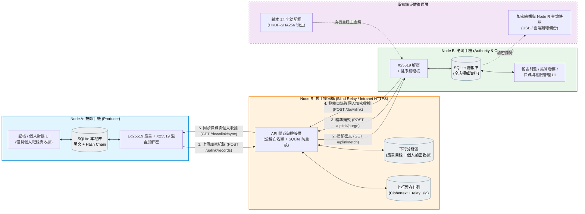
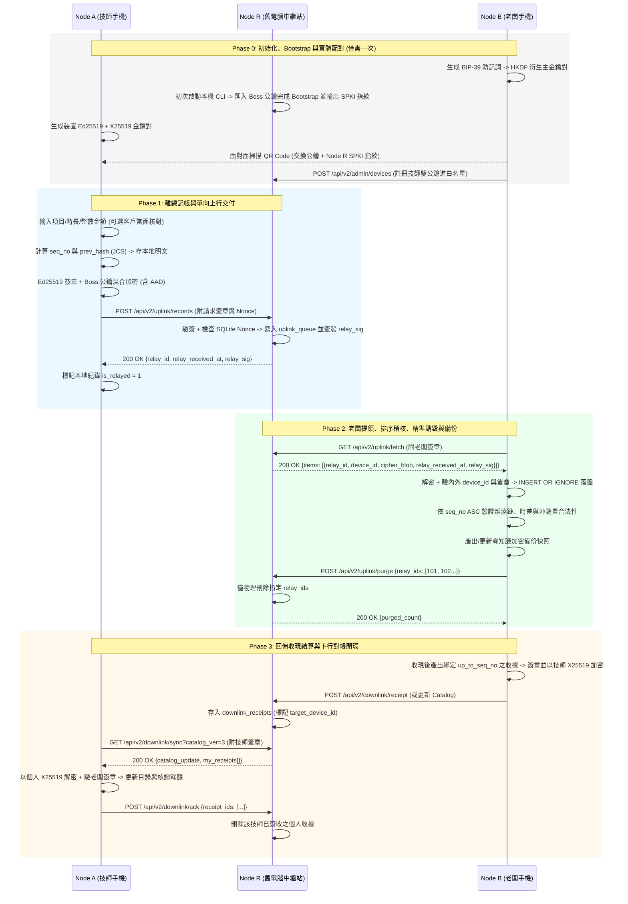

# System Specification & Sequence Document (SSD) v2.1

- **Project**: Zero-Trust Closed-Loop Edge-Relay Service Management System (`P2PServiceApp`)
- **Domain**: 實體服務業 / 按摩門市回佣與帳務管理
- **Architecture**: Offline-First Intranet Store-and-Forward（雙向零信任邊緣中繼架構）
- **Recommended Tech Stack**: Flutter (Node A / Node B), Python FastAPI + Uvicorn (Node R), SQLite (WAL Mode), Libsodium / Cryptography

---

## 0. v2.0 → v2.1 審查修訂摘要

| 類別 | v2.0 原設計缺口 | v2.1 修補規格 |
| :--- | :--- | :--- |
| 下行收據加密 | 技師端僅有 `Ed25519`，無法接收加密收據 | 技師端補齊 `X25519` 加密公私鑰，`device_registry` 新增 `encrypt_pub_key` |
| 金額精度 | SQLite 金額欄位使用 `REAL` 浮點數 | 全面改用 `INTEGER` 儲存最小貨幣單位（`*_cents`），明定 `HALF_UP` 進位 |
| 規範化序列化 | 未定義 `canonical_json` 規則 | 採 RFC 8785 (JCS) 並對原始 UTF-8 bytes 簽章與計算雜湊，原樣封裝傳輸 |
| 封包上下文綁定 | AEAD 缺少 AAD，未校對內外 `device_id` | `XChaCha20-Poly1305` 加入 AAD，老闆端強制比對內外層 `device_id` |
| BIP-39 金鑰衍生 | 未鎖死衍生路徑，改版將無法還原備份 | 鎖定 `BIP-39 64-byte Seed -> HKDF-SHA256` 搭配固定 domain separation 字串 |
| 收據核銷邊界 | 僅記時間區間，補傳舊單會導致重複核銷 | 收據綁定 `up_to_seq_no` 與 `settled_balance_cents`，上行紀錄附 `catalog_version` |
| 亂序抵達與沖銷 | 亂序抵達誤報斷鏈；缺少重複/超額沖銷檢查 | 先落盤再依 `seq_no ASC` 驗證，區分 `PENDING_GAP` 與 `HASH_BROKEN`；補 `DUPLICATE_REVERSAL` / `OVER_REVERSAL` |
| Node R 收件簽章 | Schema 與 API 遺漏 `relay_sig` | `uplink_queue` 與 `/uplink/fetch` 補上 `relay_sig`，並註明威脅模型邊界 |
| 無外網時鐘飄移 | 筆電時間飄移 >300s 導致全店 API 癱瘓 | 新增 `/health` 計算 `clock_offset` 僅供 API 簽章；老闆端偵測 Node R 時鐘異常告警 |
| 維運與相容性 | `DELETE` 帶 Body；憑證過期；缺 Bootstrap 與換機流程 | 改 `POST /api/v2/uplink/purge`；改 SPKI Pinning；Nonce 持久化 SQLite；補 CLI Bootstrap 與筆電換機備份 |

---

## 1. 系統概述與完整五大閉環 (Closed-Loop Definition)

本系統在無外網與零雲端伺服器成本的前提下，透過店內常駐的舊手提電腦（Node R）作為「盲遞中繼站」，串聯技師手機（Node A）與老闆設備（Node B），達成以下五個完整閉環：

1. **信任建立與撤銷閉環**：透過 Node R 本機 CLI 完成老闆端首次綁定（Bootstrap），再以面對面掃描 QR Code 完成技師公鑰交換與 SPKI 憑證釘選；技師離職時由老闆發佈撤銷清單，即時阻斷其寫入權限。
2. **服務紀錄上行閉環**：技師離線建檔 → 本地明文記帳 + 雜湊鏈封裝 + 混合加密 + 個人簽章 → 自動推送至 Node R → 取得 Node R 簽章收據標記已交付。
3. **提領、核對與安全銷毀閉環**：老闆驗證身份後拉取密文 → 本機解密、驗簽、依序檢查雜湊鏈連續性與冪等寫入 → 針對已持久化之精準 `relay_ids` 發送銷毀指令 → Node R 物理刪除並釋放空間。
4. **回佣結算與目錄下行閉環**：老闆收齊回佣現金後簽發綁定 `up_to_seq_no` 的加密「結算收據」，連同最新「服務目錄（Catalog）」推播至 Node R 下行區 → 技師拉取最新目錄與「僅限本人」的結算收據，完成資金對帳閉環。
5. **零知識災難復原閉環**：老闆端主金鑰由離線紙本 24 字助記詞決定性衍生；每次提領結算後，將總帳資料庫與 Node R 基礎金鑰以主金鑰加密打包為快照，同步異地備份（外接隨身碟 / 個人雲端），防止手機或筆電損壞導致資料毀滅。

---

## 2. 節點角色與權限矩陣 (Roles & Trust Boundaries)

| 節點 | 實體設備 | 持有金鑰 | 讀寫權限邊界 |
| :--- | :--- | :--- | :--- |
| **Node A (技師端)** | 技師手機 (Flutter App) | 1. 個人簽章私鑰 (`Ed25519`)<br>2. 個人解密私鑰 (`X25519`)<br>3. 老闆加密公鑰 (`X25519`)<br>4. 老闆驗簽公鑰 (`Ed25519`)<br>5. Node R TLS SPKI 指紋與驗簽公鑰 | **上行**：僅能上傳自己簽章的加密服務紀錄與沖銷單。<br>**下行**：僅能讀取全域 Catalog、以及「收件人為本人」的加密結算收據。<br>**隔離**：無法讀取 `/fetch`，無法刪除任何佇列資料。 |
| **Node R (中繼節點)** | 店內舊手提電腦 (Ubuntu + FastAPI) | 1. 節點專屬簽章金鑰 (`Ed25519`)<br>2. 自簽 TLS 私鑰<br>3. 授權名單公鑰表 (老闆 + 現役技師) | **Blind Storage**：無解密私鑰，無法讀取任何服務金額與客戶紀錄。<br>**守門員**：驗證每個 API 請求簽章、時間戳與 SQLite 持久化 Nonce，拒絕未授權或已撤銷裝置。 |
| **Node B (老闆端)** | 老闆專用手機 (Flutter App) | 1. 總控解密私鑰 (`X25519`)<br>2. 總控簽章私鑰 (`Ed25519`)<br>3. 備份加密金鑰 (`XChaCha20-Poly1305`)<br>*(均由 BIP-39 助記詞衍生，存於 Keychain/Keystore)* | **全權限**：拉取所有上行密文、精準銷毀佇列、發佈簽章 Catalog、管理裝置白名單/撤銷名單、簽發加密回佣結算收據、產出全店報表與稽核告警。 |

---

## 3. 密碼學與防弊核心規格 (Cryptography & Anti-Cheat)

### 3.1 混合加密與簽章封裝 (Sign-then-Encrypt Envelope)

1. **規範化序列化 (RFC 8785 JCS)**：將明文 JSON 依 RFC 8785 產生確定性 UTF-8 位元組 `canonical_bytes`（所有金額欄位皆為整數 `*_cents`，禁用浮點數）。
2. **雜湊鏈綁定**：每台 Node A 維護嚴格遞增整數 `seq_no`（1, 2, 3...），明文必含 `seq_no`、`catalog_version` 與 `prev_hash = SHA256(prev_canonical_bytes)`（首筆為 `GENESIS`）。
3. **身份簽章**：使用技師 `Ed25519` 私鑰對 `canonical_bytes` 簽章，產生 `therapist_sig`。
4. **混合加密（含 AAD 綁定）**：
   - 針對單筆包裹產生一次性 `X25519` 臨時金鑰對，與老闆 `X25519` 公鑰進行 ECDH 並以 `HKDF-SHA256` 衍生對稱金鑰。
   - 將 `{canonical_bytes, therapist_sig}` 經 zlib 壓縮後，使用 `XChaCha20-Poly1305` 加密，並將 `AAD = device_id || "|" || client_record_id || "|" || "v2.1"` 納入驗證。
   - 輸出 `{protocol_version, ephemeral_pub_key, nonce, ciphertext_with_tag}`。
   - 老闆端解密後**必須強制檢查**外層 `device_id` 與內層 `canonical_bytes` 解析出的 `device_id` 完全一致。
5. **下行個人收據加密**：老闆端以自身 `Ed25519` 私鑰簽章收據 `canonical_bytes` 後，使用目標技師的 `X25519` 公鑰（`encrypt_pub_key`）以相同混合加密流程封裝，確保僅該技師可解密與驗簽。

### 3.2 BIP-39 助記詞決定性金鑰衍生規範

由 24 字 BIP-39 助記詞產出 64-byte Master Seed 後，嚴格透過 `HKDF-SHA256(ikm=seed, salt="P2PServiceApp-v2.1", info=...)` 衍生 32-byte 金鑰種子：
- `info = "boss-ed25519-sign-v1"` → 老闆 `Ed25519` 簽章私鑰
- `info = "boss-x25519-enc-v1"` → 老闆 `X25519` 解密私鑰
- `info = "boss-backup-aead-v1"` → 零知識總帳與 Node R 金鑰快照加密金鑰

### 3.3 請求層認證與無外網時鐘補償

除 `GET /api/v2/health` 外，Node R 所有端點採無狀態簽章驗證：
- `X-Device-ID`: 裝置唯一識別碼（如 `BOSS_01`、`T1001`）
- `X-Timestamp`: Unix 秒級時間戳（容許與 Node R 偏差 ±300 秒）
- `X-Nonce`: 隨機 UUID v4（寫入 Node R SQLite `used_nonces` 表保留 10 分鐘，防止重啟重放）
- `X-Signature`: `Ed25519.Sign(METHOD + "\n" + PATH + "\n" + TIMESTAMP + "\n" + NONCE + "\n" + SHA256(BODY))`
- **無外網時鐘補償**：若手機收到 `401 TIMESTAMP_SKEW`，自動呼叫免簽章的 `/api/v2/health` 取得 `server_unix_ts`，計算 `clock_offset` 並僅套用於 `X-Timestamp` 重試（**嚴禁修改業務紀錄內的 `client_timestamp`**）。老闆端同步時若偵測「老闆手機時間與 Node R 差距超過 ±120 秒」，立即顯示「Node R 系統時鐘異常」紅燈提醒。

### 3.4 防弊稽核與異常偵測機制

- **Append-Only 不可篡改**：Node A 禁止修改或刪除歷史紀錄；輸錯必須建立 `record_type = "REVERSAL"` 且帶 `reversal_target_id` 與原因的新紀錄。
- **沖銷單合法性檢查**：老闆端自動偵測 `DUPLICATE_REVERSAL`（同一原單重複沖銷）與 `OVER_REVERSAL`（沖銷金額絕對值大於原單）。
- **雙重時間戳與收件簽章**：Node R 收件時寫入 `relay_received_at` 並產生 `relay_sig = NodeR_Ed25519.Sign(client_record_id || "|" || SHA256(encrypted_envelope) || "|" || relay_received_at)` 存於 `uplink_queue` 並隨 `/fetch` 回傳。（威脅模型備註：此機制防範技師篡改手機時鐘；若 Node R 本機遭實體入侵取得私鑰，則該時間戳可被偽造。）
- **亂序抵達容錯**：老闆端先將所有驗簽通過的紀錄冪等寫入 `master_ledger`，再依 `(device_id, seq_no ASC)` 掃描：尚未收齊中間序號標記為 `PENDING_GAP`（待下次同步補齊），已收齊但雜湊不符則標記紅燈 `HASH_BROKEN`。
- **客戶當面確認螢幕（UX 輔助）**：技師建檔後可切換簡潔確認畫面供客人當面核對項目、時長與金額並記錄 `customer_confirmed_at`（定位為透明核對 UX，非防技師代點的密碼學鐵證）。

---

## 4. 整體系統架構圖 (System Architecture)



---

## 5. 完整閉環時序圖 (End-to-End Closed-Loop Sequence)



---

## 6. Node R RESTful API 規格 (Intranet HTTPS)

所有端點透過自簽 TLS（App 採 SPKI Pinning）傳輸；除 `/health` 外皆強制執行第 3.3 節 Header 簽章驗權：

| 端點 | 呼叫者 | 功能說明 | 冪等與安全設計 |
| :--- | :--- | :--- | :--- |
| `GET /api/v2/health` | Node A/B | 心跳與伺服器時間回傳 | 免簽章，回傳 `{status, server_unix_ts}` 供計算 `clock_offset` |
| `POST /api/v2/uplink/records` | Node A | 批次上傳加密服務紀錄或沖銷紀錄 | 以 `client_record_id` 為唯一鍵，重複上傳回傳原 `relay_id` 與 `relay_sig` |
| `GET /api/v2/downlink/sync` | Node A | 拉取新版 Catalog 與個人加密結算收據 | 依已驗簽之 `X-Device-ID` 強制過濾，無法讀取他人收據 |
| `POST /api/v2/downlink/ack` | Node A | 確認已下載並驗證個人結算收據 | 僅清除屬於該 `X-Device-ID` 的已簽收收據 |
| `GET /api/v2/uplink/fetch` | Node B | 拉取未銷毀密文與 `relay_sig` | 支援分頁 `?limit=200&after_id=0` |
| `POST /api/v2/uplink/purge` | Node B | 精準物理刪除已落盤之紀錄 | 改用 `POST` 避免 `DELETE` Body 相容性問題；必帶 `{"relay_ids": [...]}` |
| `POST /api/v2/downlink/catalog` | Node B | 發佈新版簽章服務目錄與抽成規則 | 覆寫下行最新快照，遞增 `version` |
| `POST /api/v2/downlink/receipt` | Node B | 發佈給特定技師的加密結算收據 | 指定 `target_device_id`，內容經技師 `X25519` 加密與老闆簽章 |
| `POST /api/v2/admin/devices` | Node B | 新增/更新技師雙公鑰或撤銷離職權限 | 更新 `status` (`ACTIVE` / `REVOKED`)，立即生效 |

---

## 7. 三端資料庫 Schema 設計 (SQLite WAL Mode)

> **金額欄位規範**：所有金額皆以最小貨幣單位整數（`INTEGER`，如 RM 120.50 = `12050`）儲存，嚴禁使用 `REAL`。

### 7.1 Node A (技師手機本地庫)

```sql
CREATE TABLE local_records (
  record_id TEXT PRIMARY KEY,
  seq_no INTEGER UNIQUE NOT NULL,
  prev_hash TEXT NOT NULL,
  catalog_version INTEGER NOT NULL,
  record_type TEXT NOT NULL,             -- 'SERVICE' | 'REVERSAL'
  reversal_target_id TEXT,
  service_id TEXT,
  service_name TEXT NOT NULL,
  duration_minutes INTEGER NOT NULL,
  custom_price_cents INTEGER NOT NULL,   -- 實收金額 (沖銷時為負數)
  estimated_commission_cents INTEGER NOT NULL,
  note TEXT,
  client_timestamp TEXT NOT NULL,
  customer_confirmed_at TEXT,
  canonical_bytes BLOB NOT NULL,         -- RFC 8785 原始序列化位元組
  encrypted_envelope BLOB NOT NULL,
  is_relayed INTEGER DEFAULT 0,
  relay_received_at TEXT,
  relay_receipt_sig TEXT,
  created_at TEXT DEFAULT CURRENT_TIMESTAMP
);

CREATE TABLE settlement_receipts (
  receipt_id TEXT PRIMARY KEY,
  up_to_seq_no INTEGER NOT NULL,         -- 本次核銷截止序號 (防補傳舊單重複核銷)
  period_start TEXT NOT NULL,
  period_end TEXT NOT NULL,
  amount_settled_cents INTEGER NOT NULL,
  settled_balance_cents INTEGER NOT NULL,-- 結算當下老闆端認定之剩餘欠款
  boss_signature TEXT NOT NULL,
  settled_at TEXT NOT NULL
);

CREATE TABLE local_catalog (
  service_id TEXT PRIMARY KEY,
  name TEXT NOT NULL,
  default_duration INTEGER,
  suggested_price_cents INTEGER,
  commission_type TEXT NOT NULL,         -- 'PERCENTAGE_BPS' | 'FIXED_CENTS'
  commission_value INTEGER NOT NULL,     -- 百分比用基點 (如 30% = 3000)
  is_active INTEGER DEFAULT 1,
  catalog_version INTEGER NOT NULL
);
```

### 7.2 Node R (舊手提電腦盲遞中繼庫)

```sql
CREATE TABLE device_registry (
  device_id TEXT PRIMARY KEY,
  role TEXT NOT NULL,                    -- 'BOSS' | 'THERAPIST'
  verify_pub_key TEXT NOT NULL,          -- Ed25519 公鑰
  encrypt_pub_key TEXT NOT NULL,         -- X25519 公鑰 (供加密下行收據)
  status TEXT DEFAULT 'ACTIVE',          -- 'ACTIVE' | 'REVOKED'
  updated_at TEXT DEFAULT CURRENT_TIMESTAMP
);

CREATE TABLE used_nonces (
  nonce TEXT PRIMARY KEY,
  device_id TEXT NOT NULL,
  expires_at INTEGER NOT NULL            -- Unix 秒級過期時間，定期清理
);

CREATE TABLE uplink_queue (
  relay_id INTEGER PRIMARY KEY AUTOINCREMENT,
  client_record_id TEXT UNIQUE NOT NULL,
  device_id TEXT NOT NULL,
  encrypted_envelope BLOB NOT NULL,
  relay_received_at TEXT NOT NULL,
  relay_sig TEXT NOT NULL                -- Node R 對收件時間與密文雜湊的簽章
);

CREATE TABLE downlink_catalog (
  version INTEGER PRIMARY KEY,
  payload_json TEXT NOT NULL,
  boss_signature TEXT NOT NULL,
  updated_at TEXT DEFAULT CURRENT_TIMESTAMP
);

CREATE TABLE downlink_receipts (
  receipt_id TEXT PRIMARY KEY,
  target_device_id TEXT NOT NULL,
  encrypted_receipt BLOB NOT NULL,
  boss_signature TEXT NOT NULL,
  created_at TEXT DEFAULT CURRENT_TIMESTAMP
);
```

### 7.3 Node B (老闆權威總帳庫)

```sql
CREATE TABLE master_ledger (
  record_id TEXT PRIMARY KEY,            -- 冪等鍵 (INSERT OR IGNORE)
  device_id TEXT NOT NULL,
  therapist_name TEXT NOT NULL,
  seq_no INTEGER NOT NULL,
  prev_hash TEXT NOT NULL,
  catalog_version INTEGER NOT NULL,
  record_type TEXT NOT NULL,             -- 'SERVICE' | 'REVERSAL'
  reversal_target_id TEXT,
  service_name TEXT NOT NULL,
  duration_minutes INTEGER NOT NULL,
  custom_price_cents INTEGER NOT NULL,
  applied_commission_bps INTEGER NOT NULL,
  commission_due_cents INTEGER NOT NULL,
  client_timestamp TEXT NOT NULL,
  relay_received_at TEXT NOT NULL,
  relay_sig TEXT NOT NULL,
  audit_flags TEXT,                      -- JSON: ["PENDING_GAP", "HASH_BROKEN", "CLOCK_SKEW", "DUPLICATE_REVERSAL", "OVER_REVERSAL"]
  imported_at TEXT DEFAULT CURRENT_TIMESTAMP
);

CREATE TABLE therapist_chain_state (
  device_id TEXT PRIMARY KEY,
  therapist_name TEXT NOT NULL,
  verified_seq_no INTEGER DEFAULT 0,     -- 已連續驗證通過的最高序號
  verified_record_hash TEXT DEFAULT 'GENESIS',
  commission_override_bps INTEGER,
  status TEXT DEFAULT 'ACTIVE'
);

CREATE TABLE boss_settlements (
  receipt_id TEXT PRIMARY KEY,
  device_id TEXT NOT NULL,
  up_to_seq_no INTEGER NOT NULL,
  amount_received_cents INTEGER NOT NULL,
  remaining_balance_cents INTEGER NOT NULL,
  payment_method TEXT DEFAULT 'CASH',
  note TEXT,
  boss_signature TEXT NOT NULL,
  settled_at TEXT DEFAULT CURRENT_TIMESTAMP
);
```

---

## 8. 報表與異常稽核引擎 (Node B Local Analytics)

- **每日報告 (Daily Report)**：當日總客單數、總實收金額、總應收回佣、各技師欠款清算表，以及異常稽核紅燈看板：
  1. `PENDING_GAP` / `SEQ_GAP`：序號暫時缺號或長期斷號。
  2. `HASH_BROKEN`：已收齊序號但雜湊鏈不連續（高度懷疑篡改）。
  3. `CLOCK_SKEW`：單筆 `client_timestamp` 與 `relay_received_at` 落差過大；若老闆手機與 Node R 時差過大，另顯示「Node R 時鐘異常」系統級警告。
  4. `DUPLICATE_REVERSAL` / `OVER_REVERSAL` / `HIGH_REVERSAL`：重複沖銷、超額沖銷或當日沖銷比例異常。
- **每週 / 每月報告**：營收與回佣趨勢、熱門服務佔比、技師產值與準時結算率，支援一鍵匯出加密 CSV / PDF。

---

## 9. 實務部署與硬體容錯規範 (Operations & Resilience)

1. **憑證釘選與網路發現**：
   - App 採用 **SPKI 公鑰指紋 Pinning**，避免自簽憑證年限限制或到期導致全店斷線。
   - Node R 啟用 Avahi/mDNS（`salon-relay.local`）並搭配路由器 MAC 靜態 IP 綁定；Flutter 端內建 mDNS 解析（如 `bonsoir`）並快取「上次成功連線 IP」作為自動 Fallback。
   - 路由器故障備援：筆電預先設定離線 Wi-Fi Hotspot，斷網時可讓手機直連同步。
2. **Bootstrap 與硬體換機復原**：
   - 首次部署由 Node R 本機 CLI 匯入老闆公鑰並印出配對 QR Code（含 Node R 公鑰與 SPKI 指紋）。
   - 將 Node R 的 TLS 私鑰與 `Ed25519` 金鑰納入老闆端加密快照備份，筆電故障換新機時直接還原金鑰，全店技師手機無需重新掃碼配對。
3. **舊筆電 24/7 調校**：
   - Ubuntu Minimal + `systemd` 守護 FastAPI（崩潰 3 秒自動重啟）+ `HandleLidSwitch=ignore`（闔蓋不休眠）+ `tlp` 鎖定充電上限 60% 兼作停電 UPS。
4. **跨平台派發取捨**：
   - Android 由 Node R 內網靜態頁面提供 `.apk` 下載。
   - iOS TestFlight 版本每 90 天強制過期，若門市無專職 IT 定期續簽且需長期支援 iOS 技師，建議評估技師端改採內網 PWA（搭配 WebCrypto / WASM libsodium）。
